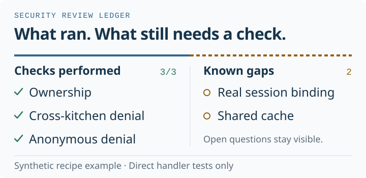

# Security Review Ledger

**A security review the next developer can pick up.**

An Agent Skill that keeps performed checks, their evidence and known gaps in one versioned Markdown ledger. Each scenario has a stable ID, so a new reviewer can see what happened, what remains open and what needs checking again.

[Try it](#try-it) · [Read the example](examples/recipe-access/review.md) · [Discuss](https://github.com/goAuD/security-review-ledger/discussions) · [Contribute](CONTRIBUTING.md) · [Release notes](releases/README.md)



## Five passing tests. Two open questions.

Two kitchens use the same recipe service. The [working example](examples/recipe-access/review.md) shows exactly what the tests establish and where their evidence stops.

| Checks performed | Known gaps and follow-up |
| --- | --- |
| **SR-001** — A member can read their kitchen's recipe. | **SR-004** — Does the real login system bind the session to the right kitchen? |
| **SR-002** — Foreign and missing recipes have matching responses. A forged kitchen query or header also leaves a permitted read unchanged. | **SR-005** — Could a shared cache serve one kitchen's response to another? |
| **SR-003** — An anonymous request receives no recipe data. | Both questions need checks outside this in-memory fixture. |

The two views point to the same scenario records. An unresolved finding can appear in both: the check happened, and work remains. A relevant change marks earlier evidence for recheck while keeping its history.

## Try it

From the project you want to review, choose the relevant client when prompted.

```sh
npx skills add goAuD/security-review-ledger@v0.1.1 --skill security-review-ledger
```

Then give the agent a bounded task:

> Use Security Review Ledger to review access to one recipe across two kitchens. Read the requirement, run the available local checks, and show the evidence alongside the known gaps. Keep any production assumptions explicit.

The agent returns the ledger in the conversation unless you choose a suitable file location. The review uses Markdown and the tools already available in your project.

<details>
<summary><strong>Manual installation and local discovery</strong></summary>

Copy the entire [skill folder](skills/security-review-ledger) into the project skill directory documented by your client. You can also give an agent the folder and ask it to follow its instructions.

With a local checkout, discover the skill from the repository root:

```sh
npx skills add . --list
```

The [skills CLI](https://github.com/vercel-labs/skills) requires Node.js 22.20 or later at the time of writing. Manual use of the Markdown instructions does not require Node.js. The CLI's optional install telemetry can be disabled with `DISABLE_TELEMETRY=1`; see its [telemetry documentation](https://github.com/vercel-labs/skills/blob/main/docs/troubleshooting.md#telemetry).

</details>

## Run the example in a minute

Use Node.js 22.20 or later. The example calls the handler in memory, uses the built-in test runner and requires no package installation or server.

```sh
git clone https://github.com/goAuD/security-review-ledger.git
cd security-review-ledger
node --test --test-reporter=tap examples/recipe-access/read-recipe.test.mjs
```

Read the [requirement](examples/recipe-access/requirement.md), then compare your results with the [latest recorded run](examples/recipe-access/evidence/a3-20261106T092335Z.tap) and [sample ledger](examples/recipe-access/review.md). The ledger preserves the earlier three-test runs alongside the new five-test run, with each attempt's date, environment and file digests. Your run is new evidence.

## What goes into a review

[SKILL.md](skills/security-review-ledger/SKILL.md) defines the operating contract. Each scenario connects an expected behavior to its source, a procedure, an observed result, evidence and limits. Code-derived expectations stay labeled as assumptions. Unexecuted tests stay open.

| File | Purpose |
| --- | --- |
| [Skill instructions](skills/security-review-ledger/SKILL.md) | Define scope, check claims, preserve attempts and report in the user's language. |
| [Ledger template](skills/security-review-ledger/assets/ledger-template.md) | Start a review with two views of one set of scenario records. |
| [Standards references](skills/security-review-ledger/references/standards.md) | Select bounded mappings to ISO/IEC 27034-1, NIST SSDF and OWASP ASVS. |
| [Local evidence guide](skills/security-review-ledger/references/local-evidence.md) | Select the project runtime, distinguish attempted from completed checks and preserve private evidence. |

The instructions include a requirement/hypothesis table and scenario matrix, and record whether a check reached its target and assertion. See the [v0.1.1 notes](releases/v0.1.1.md) for verification and limits. An installation pinned to `v0.1.0` keeps the earlier instructions until explicitly updated.

Conclusions apply to the examined scope. Standards references do not establish compliance, and an empty gap list does not establish complete coverage. Keep private application reports in an authorized location; the examples here use synthetic data.

## Help shape the next review

Useful contributions include a clearer instruction, a small synthetic example or a reproducible report from a client you use. Two focused tasks are open:

- [Add a small `recheck-needed` example](https://github.com/goAuD/security-review-ledger/issues/1) — preserve an old result while recording a changed requirement and a fresh check. **Good first issue.**
- [Verify one Claude Code workflow](https://github.com/goAuD/security-review-ledger/issues/2) — run the synthetic example in an actual client session and document its evidence and limits. **Help wanted.**

Share your experience or ask a question in the [welcome discussion](https://github.com/goAuD/security-review-ledger/discussions/3). For a concrete change, start with [CONTRIBUTING.md](CONTRIBUTING.md), [suggest an improvement](https://github.com/goAuD/security-review-ledger/issues/new?template=improvement.md), or fork the repo and open a pull request. You do not need a collaborator invitation. Report vulnerabilities through the [private security channel](SECURITY.md).

## Compatibility and evidence

The skill follows the [open Agent Skills format](https://agentskills.io/specification) and is listed on [skills.sh](https://www.skills.sh/goaud/security-review-ledger/security-review-ledger). Client permissions determine which checks an agent can run.

| Check | Evidence and boundary |
| --- | --- |
| Recipe handler | The [current example review](examples/recipe-access/review.md) records five passing tests on Windows with Node.js 22.23.4. The [v0.1.1 CI run](https://github.com/goAuD/security-review-ledger/actions/runs/42294067442) passed all five tests on Linux and Windows with Node.js 22.20.0 and 24. |
| Codex and Claude Code installation | A fresh `v0.1.1` installation on Windows with skills CLI 1.7.6 and Node.js 22.23.4 matched all five files for each client. See the [version evidence](releases/v0.1.1.md). |
| Agent behavior | Two paired synthetic Codex trials checked execution boundaries and preservation of historical evidence after a changed requirement; see the [results and limits](releases/v0.1.1.md). Installation does not establish workflow behavior. An actual Claude Code workflow and additional clients remain open checks. |
| Automated checks | [GitHub Actions](https://github.com/goAuD/security-review-ledger/actions/workflows/checks.yml) runs the example on Linux and Windows with Node.js 22.20.0 and 24. Inspect the run for the revision you use. |

<details>
<summary><strong>Recorded installation check · 2026-11-06</strong></summary>

On 2026-11-06, the skills CLI 1.7.6 installed the [reviewed revision](https://github.com/goAuD/security-review-ledger/commit/9b9aad4a42af110f2dc5e95d0769bea5473e503b) from public GitHub into a fresh project on Node.js 24.22.1. The command used was:

```sh
npx --yes skills@1.7.6 add goAuD/security-review-ledger --skill security-review-ledger --agent codex --agent claude-code --copy --yes
```

The four files installed for each client matched the originals byte for byte. The CLI recorded `skills/security-review-ledger/SKILL.md` as the source. This check covered installation into `.agents/skills/` and `.claude/skills/`.

</details>

## License

[MIT](LICENSE) · goAuD and contributors.
